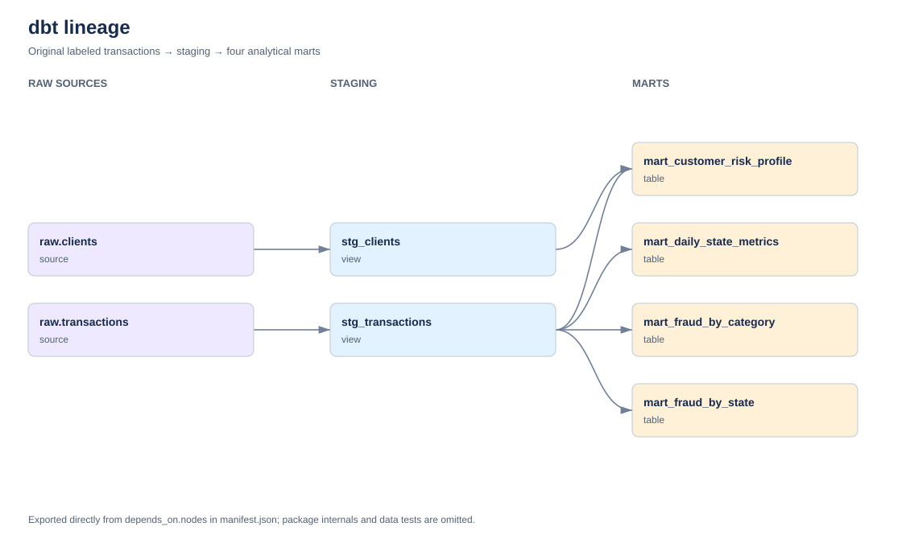

# Аналитика транзакций в ClickHouse и dbt

Проект строит четыре аналитические витрины по размеченным транзакциям. Преобразования, проверки качества и документация выполняются через dbt; повторяемый запуск собран в Makefile.

## 1. Модель данных от raw до витрин

```text
train.csv → transactions_db.transactions → stg_transactions → четыре mart-модели
                      client_id                 ↑
SQLite-реестр → transactions_db.clients → stg_clients
states.csv → справочник регионов и проверки связей
```

Исходная таблица содержит все 17 полей CSV, `target` и технические ключи. Для анализа используется размеченный `train.csv`; строки без `target` не загружаются. Суммы хранятся как `Decimal(18,2)`, чтобы сохранять копейки. Время источника без часового пояса трактуется как UTC без пересчёта по штатам.

Загрузчик проверяет CSV до публикации и заполняет временную таблицу. Готовая таблица транзакций заменяется атомарно. Повтор того же источника сверяет хеш и контрольные показатели и не добавляет строки повторно. Технический `transaction_id` — номер записи в опубликованном файле; одинаковые по содержимому разные строки файла не объединяются.

### Реестр клиентов

Клиенты хранятся отдельно в SQLite, в томе `registry_data`. Поле `client_id` — `INTEGER PRIMARY KEY AUTOINCREMENT`. Ограничение `UNIQUE` задано на комбинацию имени, фамилии, улицы, города, региона и почтового индекса. Хэш для ключа клиента не используется.

ID сохраняется после повторной загрузки и изменения порядка строк. Новые клиенты получают новые ID; существующие не перенумеровываются. Два клиента с одинаковыми именами и разными адресами имеют разные ключи. Это правило идентификации по доступным полям: смена адреса создаёт новую запись, а полностью совпадающие идентификационные поля объединяются.

Для аналитических соединений реестр копируется в `transactions_db.clients`. Сначала публикуется справочник, содержащий прежние ключи, затем таблица транзакций. База и реестр имеют общий UUID состояния: случайная подмена одного тома обнаруживается загрузчиком.

### Staging и витрины

`stg_transactions` нормализует категории, мерчантов, пол и коды регионов, приводит типы, вычисляет дату, ISO-день недели, сегмент суммы и признак крупной операции. `stg_clients` нормализует справочник клиентов. Staging материализуется представлениями, витрины — таблицами MergeTree.

| Витрина | Гранулярность | Метрики |
| --- | --- | --- |
| `mart_daily_state_metrics` | Дата UTC и регион | Количество операций, сумма, средний чек, точный P95, доля крупных операций |
| `mart_fraud_by_category` | Категория | Число операций и фродов, fraud_rate, общая сумма и сумма фрода |
| `mart_fraud_by_state` | Регион | Число операций и фродов, fraud_rate, уникальные клиенты и мерчанты, суммы |
| `mart_customer_risk_profile` | client_id | Первая и последняя операция, число операций и фродов, средний чек, суммы, fraud_rate, уровень риска |

`fraud_rate` измеряется в процентах от 0 до 100. Доля крупных операций — от 0 до 1. Крупная операция начинается с 1 000; порог задаётся `large_amount_threshold`. P95 рассчитывается `quantileExact(0.95)`. Уникальность мерчанта определяется нормализованным значением поля `merch`.

Сегменты клиентов: HIGH при fraud_rate от 5%, MEDIUM от 1%, LOW ниже 1%. Пороги `risk_high_pct` и `risk_medium_pct` находятся в `dbt_project.yml`. Это явно заданные правила сегментации по наблюдаемой истории.

Справочник содержит 50 штатов и округ Колумбия. DC имеет тип `FEDERAL_DISTRICT`; это отдельный регион, а не неопределённое значение.

## 2. Описания, макросы и тесты

В YAML описаны источники, staging, все витрины, справочник и их колонки. Описания объясняют бизнес-смысл показателей, единицы измерения и ключи.

Собственные макросы:

- `amount_bucket`: SMALL до 50, MEDIUM от 50 до 200, LARGE от 200 до порога крупной операции, VERY_LARGE от порога.
- `customer_risk`: классификация HIGH/MEDIUM/LOW по настраиваемым порогам.
- `validate_business_rules`: проверка согласованности порогов перед выполнением.

Стандартные тесты проверяют `not_null`, `unique`, `accepted_values`, связи клиентов и регионов. Составные ключи проверяются `dbt_utils.unique_combination_of_columns`.

Восемь singular SQL-тестов проверяют неотрицательность сумм, границы и формулу fraud_rate, равенство количества операций и сумм между слоями, число фродов и суммы фрода, календарные поля, доли и P95, целостность клиентских ключей и граничные значения двух бизнес-макросов.

Python-тесты отдельно проверяют ограничения SQLite, сохранение ID, порядок строк, точность сумм, повтор загрузки, отказ на плохих данных и восстановление после сбоя до публикации. Они используют синтетический CSV и изолированные базы ClickHouse.

## 3. Документация

`dbt docs generate` создаёт описания, каталог и граф зависимостей. После полного запуска откройте [dbt Docs](http://localhost:8080):

```bash
make serve
```

PowerShell без установленного Make:

```powershell
docker compose --profile docs up -d dbt-docs
```

Внутри документации можно открыть модель, посмотреть SQL, описания колонок, тесты и lineage. Артефакты находятся в `dbt/target/`.

Граф ниже экспортируется из настоящего `manifest.json` командой `make docs`: два источника, два staging-представления и четыре витрины, семь связей.



Это SVG-экспорт графа. Скриншот страницы dbt Docs остаётся приложить вручную: открыть интерфейс, включить lineage и сохранить изображение в `docs/dbt_docs.png`. Автоматическое снятие скриншота в текущей сессии заблокировано политикой доступа браузера к localhost; сам сервер документации и его артефакты проверены.

## 4. Пакеты и команды запуска

Используются:

- `dbt_utils` — тесты составной уникальности.
- `dbt_date` — вычисление ISO-дня недели.
- `dbt_project_evaluator` — проверки структуры, документации и покрытия тестами. Пакет действительно выполняется отдельным шагом Makefile.

Для ClickHouse предусмотрены две воспроизводимые адаптации evaluator: собственный dispatch-макрос обходит граф через recursive CTE, а `scripts.prepare_packages` после `dbt deps` добавляет явные псевдонимы двум колонкам пакета. Скрипт проверяет закреплённую версию и отказывается менять неожиданный SQL. Прямые ручные правки установленного пакета не нужны.

Все 29 проверок evaluator включены. В seed исключений перечислены только две проверки freshness для статических источников `raw.transactions` и `raw.clients`: это исторический снимок CSV и его справочник, у них нет SLA поступления новых событий. Допустимый fanout staging настроен на четыре витрины: проверка сигнализирует начиная с пяти зависимых моделей.

Версии Python-зависимостей закреплены в `requirements.txt`, пакетов dbt — в `packages.yml` и `package-lock.yml`. Пароли читаются из переменных окружения, `profiles.yml` не содержит секретов.

Нужны Docker Engine с Linux-контейнерами и Compose v2. GNU Make на хосте удобен, но не обязателен: он установлен в контейнере. Для локального окружения достаточно начать с 4 CPU и 6 ГБ памяти Docker; ClickHouse ограничен 2 ГБ.

Создайте `.env`, если файла ещё нет: PowerShell — `Copy-Item .env.example .env`; Bash — `cp .env.example .env`. Положите размеченный файл в `teta-ml-1-2025/train.csv` или задайте `TRAIN_DATA_CSV`. Уже скачанные данные используются на месте и монтируются только для чтения.

С Make на хосте:

```bash
make all
make serve
```

PowerShell или Bash без Make на хосте:

```bash
docker compose build dbt
docker compose run --rm dbt make all IN_CONTAINER=1
docker compose --profile docs up -d dbt-docs
```

Полный цикл включает проверку и загрузку источника, `dbt deps`, `dbt seed`, `dbt run`, `dbt test`, запуск и тесты evaluator, генерацию документации, Python-тесты и независимую сверку всех строк витрин с CSV.

| Команда | Действие |
| --- | --- |
| `make load` | Проверить и загрузить исходный CSV |
| `make deps` | Установить закреплённые пакеты |
| `make seed` | Загрузить справочник регионов |
| `make run` | Построить staging и четыре витрины |
| `make test` | Выполнить generic и singular тесты проекта |
| `make evaluate` | Построить и проверить модели evaluator |
| `make docs` | Сгенерировать dbt Docs |
| `make check` | Проверить загрузчик и сверить каждую строку витрин с CSV |
| `make down` | Остановить сервисы с сохранением данных |

В контейнере те же цели вызываются как `docker compose run --rm dbt make <цель> IN_CONTAINER=1`; цели управления Docker `build`, `up`, `serve` и `down` выполняются на хосте.

Проект Compose называется `transaction-analytics` и использует отдельные тома. ClickHouse доступен на `localhost:8123`, dbt Docs — на `localhost:8080`; порты настраиваются в `.env`.

## 5. Результаты проверки

Полный цикл `make all IN_CONTAINER=1` завершился успешно на исходном CSV. Повторная загрузка вернула `unchanged`: данные не задублировались, клиентские ID сохранились.

| Проверка | Результат |
| --- | --- |
| Тесты данных dbt | 118 из 118 прошли, включая 8 singular SQL-тестов |
| dbt_project_evaluator | 29 из 29 прошли, без предупреждений и ошибок тестов |
| Python-тесты загрузчика и реестра | 9 из 9 прошли, без пропусков |
| Независимая сверка | Каждая строка всех четырёх витрин совпала с расчётом по CSV |
| dbt Docs | Сгенерированы index, manifest и catalog; сервер отвечает |

В исходнике 786 431 транзакция, 4 504 фрода (0,572714%), общая сумма **55 239 932,49**, 965 клиентов, 693 мерчанта и 51 регион.

| Витрина | Число строк |
| --- | ---: |
| `mart_daily_state_metrics` | 21 386 |
| `mart_fraud_by_category` | 14 |
| `mart_fraud_by_state` | 51 |
| `mart_customer_risk_profile` | 965 |

Распределение клиентов по риску: HIGH — 57, MEDIUM — 230, LOW — 678.

Проверенное окружение: `dbt-core 1.10.23`, `dbt-clickhouse 1.10.3`, `clickhouse-connect 0.10.0`, ClickHouse `26.8.20.9`. Пакеты: `dbt_utils 1.4.1`, `dbt_date 0.21.0`, `dbt_project_evaluator 1.4.1`.

Машиночитаемые результаты: [validation.json](reports/validation.json). Сохранены [лог тестов dbt](reports/dbt_test.log), [лог evaluator](reports/project_evaluator_test.log) и [полный вывод запуска](reports/acceptance.log).

Сверка вычисляет эталон непосредственно из CSV и сравнивает каждую строку четырёх витрин: ключи, количества, суммы, fraud_rate, distinct-счётчики, средние, P95, доли, даты активности и риск. Общее равенство итогов дополняется проверкой каждой группы. SHA-256 файла зафиксирован в отчёте; исходные данные и сгенерированные зависимости в Git не включены.

## Диагностика и сохранность состояния

```bash
docker compose ps -a
docker compose logs --tail=100 clickhouse
docker compose run --rm dbt dbt debug --project-dir dbt --profiles-dir dbt
docker compose --profile docs down
```

`down` сохраняет тома ClickHouse и клиентского реестра. Сбрасывать их нужно вместе: потеря только реестра нарушит соответствие ID. `docker compose --profile docs down -v` удаляет данные этого проекта, после чего исходный CSV можно загрузить заново.

Для намеренной замены источника существует `python -m scripts.load_source --replace`. Она сохраняет ранее выделенные ID клиентов, заменяет снимок транзакций и требует последующего пересчёта витрин. При загрузке и пересчёте не запускайте параллельное обновление источника.

Обычные рабочие команды не создают коммитов и не публикуют изменения в Git.
