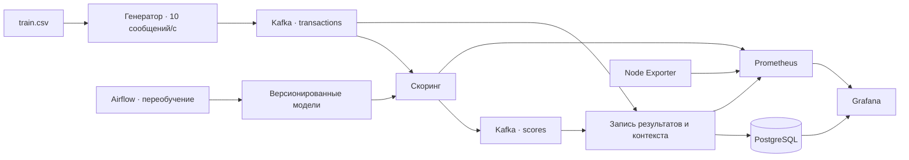

# Мониторинг потокового антифрода

Kafka передаёт транзакции в скоринг, результаты сохраняются в PostgreSQL. Airflow переобучает модель и публикует подходящую версию, а скоринг подхватывает её без перезапуска. Prometheus и Grafana показывают скорость обработки, распределение скоров, смену модели и бизнес-срез по штатам и продавцам.

## 1. Запуск

Нужны Docker Desktop с Linux-контейнерами, Compose v2 и размеченный `train.csv` из [teta-ml-1-2025](https://www.kaggle.com/competitions/teta-ml-1-2025). Рекомендуется выделить Docker 4 CPU и 8 ГБ RAM. Обучение и inference используют CPU.

Распаковать CSV в `teta-ml-1-2025/train.csv`. Другой путь задаётся через `TRAIN_DATA_CSV` в `.env`. CSV, ZIP и пароли в Git не попадают.

```powershell
Copy-Item .env.example .env
docker compose config --quiet
docker compose build scoring-service airflow-init
docker compose up -d --no-build
docker compose ps -a
docker compose logs --tail=50 data-init model-init airflow-init
```

Если `.env` уже существует, сохранить свои настройки. Init-контейнеры должны завершиться с кодом 0. Первый запуск загружает данные и обучает начальную модель, поэтому занимает несколько минут. Генератор начинает работу после готовности скоринга и записи результатов.

По умолчанию Airflow выполняет одну задачу за раз (`AIRFLOW_PARALLELISM=1`), чтобы загрузка данных, обучение и DQ не конкурировали за память одновременно. При достаточных ресурсах значение можно увеличить. Расписание каждые пять минут не гарантирует завершение тяжёлого DAG за пять минут: следующий запуск ждёт предыдущий.

Бюджет обучения задаётся `TRAIN_ITERATIONS`, по умолчанию 100. Для более длительного обучения можно увеличить его в `.env`; в продолжении описанной ниже приёмки использовано 300. Условия публикации: обе метрики на одном свежем месяце должны быть не хуже метрик действующей версии.

| Интерфейс | Адрес | Доступ по умолчанию |
| --- | --- | --- |
| Grafana | [localhost:3000](http://localhost:3000) | admin / admin |
| Prometheus | [localhost:9090](http://localhost:9090) | Без пароля |
| Airflow | [localhost:8081](http://localhost:8081) | admin / admin |
| Метрики скоринга | [localhost:8000/metrics](http://localhost:8000/metrics) | Без пароля |
| Метрики записи | [localhost:8001/metrics](http://localhost:8001/metrics) | Без пароля |

Порты и учётные данные перечислены в `.env.example`. Grafana может предложить изменить пароль при первом входе; для локальной демонстрации этот шаг можно пропустить. После смены пароля обновить `GRAFANA_ADMIN_PASSWORD` для приёмочной команды.

Проект `fraud-monitoring` имеет отдельные тома и каталог `artifacts/monitoring/`. Старые проекты и их данные не подключаются. PostgreSQL-источник Grafana использует отдельного пользователя с правом чтения представления мониторинга.

### Makefile и PowerShell

| Команда | Эквивалент без Make |
| --- | --- |
| `make up` | Сборка и запуск из инструкции выше |
| `make down` | `docker compose --profile ui down` |
| `make logs` | `docker compose logs --tail=100 scoring-service scores-sink transaction-simulator grafana` |
| `make stream-stop` | `docker compose stop transaction-simulator` |
| `make stream-start` | `docker compose up -d --no-deps transaction-simulator` |
| `make retrain` | `docker compose exec airflow-scheduler airflow dags trigger retrain_model` |
| `make test` | `docker compose run --rm --no-deps tools python -m unittest discover -s tests -v` |
| `make verify` | `python -m scripts.verify_monitoring` |

Приёмочной команде нужен Python 3.11+ на хосте; сторонние Python-пакеты не требуются.

Streamlit оставлен для ручной отправки CSV: `docker compose --profile ui up -d --build interface`, адрес [localhost:8501](http://localhost:8501). Его включение необязательно.

## 2. Поток и хранение



Генератор циклически читает CSV, присваивает каждой отправке новый UUID и удаляет `target`. Скорость задаётся `STREAM_RATE`, по умолчанию 10 сообщений/с. Исходные признаки и историческое время операции сохраняются. Это живой поток с настоящим inference.

Вход скоринга: `transaction_id` и `data`. Выход: `transaction_id`, `score`, `fraud_flag`, `model_version`. Контракт не расширялся. После подтверждённой публикации результата подтверждается входное сообщение.

Сервис записи независимо читает оба топика. `transaction_context` содержит штат, продавца, категорию, сумму и время отправки; `transaction_scores` — результат и время Kafka-публикации скора. Представление `monitoring_scores` соединяет их по ID. Любая часть может прийти первой, повторная доставка не создаёт новую строку.

Графики текущего потока используют время публикации скора, а не историческую дату исходной операции. Результаты без контекста остаются в общей статистике и видны на диагностической панели; бизнес-фильтры используют только сопоставленные записи.

Доставка имеет семантику at least once. Смещение Kafka подтверждается асинхронно только после публикации результата или commit БД. Ошибка подтверждения допускает повторную доставку; PostgreSQL устраняет дубли по ID. Ожидание доставки в Kafka не прерывается из-за промежуточного таймаута `flush`: сервис ждёт окончательного результата публикации. Счётчики процесса не являются бухгалтерским реестром: при аварии между commit и обновлением метрики возможна разница с БД. Для точного числа сохранённых результатов используется PostgreSQL.

## 3. Метрики

Prometheus собирает показатели каждую секунду, Grafana обновляется раз в 5 секунд. ID транзакций и продавцов не становятся метками Prometheus.

| Метрика | Смысл |
| --- | --- |
| `fraud_processed_total` | Подтверждённые публикации результата в Kafka |
| `fraud_flagged_total` | Опубликованные результаты с флагом фрода |
| `fraud_processing_seconds` | Гистограмма времени от разбора сообщения до подтверждения публикации, без ожидания следующего сообщения |
| `fraud_score` | Гистограмма опубликованных скоров |
| `fraud_invalid_total` | Некорректные входные сообщения |
| `fraud_processing_errors_total` | Неожиданные ошибки inference и публикации |
| `fraud_last_processed_timestamp_seconds` | Последняя успешная обработка |
| `fraud_started_timestamp_seconds` | Начало работы процесса |
| `fraud_model_reloads_total{version}` | Успешные замены модели после начальной загрузки |
| `fraud_model_reload_timestamp_seconds{version}` | Время успешной замены на указанную версию |
| `fraud_model_active{version}` | 1 для активной версии, 0 для предыдущих |
| `fraud_model_reload_errors_total` | Неудачные попытки загрузки комплекта |
| `sink_scores_written_total`, `sink_flagged_total` | Новые сохранённые скоры и флаги |
| `sink_write_seconds`, `sink_score` | Гистограммы времени вставки с commit и сохранённых скоров |
| `sink_contexts_written_total` | Новые контексты транзакций |
| `sink_duplicates_total{kind}` | Повторные доставки |
| `sink_invalid_total{kind}`, `sink_write_errors_total` | Некорректные сообщения и ошибки БД |
| `node_*` | CPU, память, сеть, файловые системы и дисковый ввод-вывод |

У гистограмм есть стандартные серии `_bucket`, `_sum`, `_count`. Доля фрода вычисляется по приростам счётчиков за минуту. Длительность обработки показана квантилями p50/p95. Метрики новых записей увеличиваются только после commit и не увеличиваются при повторе.

Собственная дополнительная метрика — `fraud_invalid_total`. Она помогает заметить, что сообщения продолжают приходить, но часть отбрасывается. Смотреть панель «Некорректные входные сообщения / с» на дашборде скоринга и соответствующий алерт.

Для проверки открыть [Prometheus Targets](http://localhost:9090/targets): три цели должны быть UP. Запрос `rate(fraud_processed_total[1m])` показывает положительную скорость, `sink_scores_written_total` растёт.

## 4. Дашборды

Конфигурация в `monitoring/` автоматически подключает два источника, четыре дашборда и два алерта. JSON и запросы подготовлены для этого проекта, импорт готовых семинарских дашбордов не нужен.

| Дашборд | Содержание |
| --- | --- |
| [Скоринг](http://localhost:3000/d/fraud-scoring) | TPS, p50/p95, доля флагов, heatmap скоров, неверные сообщения, активная версия и её смена; рядом таблица PostgreSQL по версиям |
| [Запись результатов](http://localhost:3000/d/fraud-storage) | Скорость и время записи, число флагов, повторы, ошибки, heatmap и результаты без контекста |
| [Система](http://localhost:3000/d/fraud-system) | CPU, память, сеть, свободное место и дисковый ввод-вывод |
| [Бизнес-срез](http://localhost:3000/d/fraud-business) | Фильтры штата/продавца, плотность, TPS, категории, суммы и версии |

Скриншоты работающих панелей: [скоринг](reports/screenshots/scoring.png), [запись результатов](reports/screenshots/storage.png), [система](reports/screenshots/system.png), [бизнес-срез](reports/screenshots/business.png).

Фильтры поддерживают несколько значений и «Все». Список продавцов зависит от выбранных штатов. После смены штата можно вернуть продавцов в «Все», чтобы убрать пустое пересечение. DC сохраняется отдельным значением.

Плотность скоров — нормированная гистограмма из 20 интервалов шириной 0,05, включая 0 и 1; площадь равна 1. При пустой выборке плотность не определена. TPS считается по 10-секундным интервалам с нулями в пропусках.

Для доли фрода по категориям сначала выбираются последние 1000 записанных результатов глобально, затем применяются фильтры. Общий диапазон времени на эту панель не влияет. Рядом показан фактический размер среза.

Дополнительный бизнес-график — сумма операций с флагом фрода по категориям. Он отличает частые мелкие срабатывания от редких крупных. Здесь фрод означает решение модели с порогом 0,98; это не подтверждённое мошенничество, а сумма не равна предотвращённому ущербу.

На Windows Node Exporter наблюдает Linux-окружение Docker. CPU и память относятся к Linux-ядру, диски — к доступным Linux-устройствам и смонтированным файловым системам. Сеть относится к сетевому пространству Node Exporter в bridge-сети, не ко всей Windows или суммарному трафику всех контейнеров.

## 5. Модель и алерты

Airflow сохраняет три DAG, расписание — каждые пять минут; любой можно запустить вручную через UI:

| DAG | Назначение |
| --- | --- |
| `supply_labeled_batch` | Поставка размеченного батча в следующий месяц и очистка истории; `SUPPLY_BATCH_SIZE=100000`, `HISTORY_MONTHS=36` |
| `retrain_model` | Обучение на двух месяцах, сравнение на третьем, сохранение кандидата и решение о публикации |
| `data_quality` | Проверка данных текущего окна и HTML-отчёт с результатом каждого правила |

Кандидат и активная модель оцениваются на одном свежем месяце: основная метрика — PR-AUC (`average_precision`), дополнительная — ROC-AUC. Публикация разрешена, если обе не ухудшились с погрешностью `1e-8`. При отсутствии обоих классов оценка блокируется. Отклонённый кандидат сохраняется, активная версия остаётся прежней.

Комплекты моделей находятся в `artifacts/monitoring/models/`, HTML-отчёты — в `artifacts/monitoring/dq_reports/`. Активная версия задаётся атомарным указателем `models/active.json`. Новый комплект полностью загружается и проверяется до замены в памяти.

```powershell
docker compose exec airflow-scheduler airflow dags trigger retrain_model
```

Проверить версии записанных результатов:

```powershell
docker compose exec postgres psql -U fraud -d fraud -c "SELECT model_version, count(*), max(scored_at) FROM transaction_scores GROUP BY model_version;"
```

После публикации следующая транзакция использует новую версию. Grafana показывает аннотацию с её названием примерно 30 секунд. В истории соответствующего временного диапазона отметка сохраняется. Первая загрузка, отказ публикации и повреждённый комплект не создают ложное событие успешной замены.

Если кандидат отклонён, можно обработать следующее окно. Приёмка пробует до пяти окон и сообщает ошибку, если ни один кандидат не принят; принудительного обхода проверки нет.

Правила видны в [Alerting](http://localhost:3000/alerting/list), проверяются каждые 10 секунд. Доставка уведомлений наружу не настроена.

| Правило | Условие | Проверка |
| --- | --- | --- |
| Поток скоринга остановился | Более 60 секунд без успешной обработки, ещё 30 секунд pending; первые 120 секунд процесса исключены | Остановить генератор, дождаться обработки очереди и срабатывания; запустить обратно |
| Некорректный входной поток | Доля неверных сообщений за минуту выше 1%, минимум 20 сообщений, 30 секунд pending | Отправить 900 сообщений с 10% неверных; дождаться срабатывания и восстановления |

```powershell
docker compose stop transaction-simulator
# После проверки:
docker compose up -d --no-deps transaction-simulator

docker compose run --rm --no-deps transaction-simulator python -m transaction_simulator.app --rate 10 --limit 900 --invalid-ratio 0.1
```

Второй сценарий работает рядом с обычным генератором. После завершения минутное окно очищается, алерт возвращается в норму. Недоступность метрик отражается как No Data / Error, а не как здоровый сервис.

## 6. Проверки и результаты

```powershell
docker compose run --rm --no-deps tools python -m unittest discover -s tests -v
docker compose run --rm --no-deps -e INTEGRATION_TESTS=1 tools python -m unittest discover -s tests/integration -v
docker compose exec airflow-scheduler python -m unittest tests.test_dags -v
python -m scripts.verify_monitoring
```

Интеграционные тесты создают приватные схемы PostgreSQL. Проверяются порядок доставки, повторы, отказ записи, SQL реальных панелей, DC, кавычки, пустой срез, крайние скоры, плотность, TPS, последние 1000 и суммы.

Приёмка проверяет метрики и запросы панелей через API, запускает реальные DAG, сравнивает ID, время запуска и число рестартов скоринга, проверяет новую версию и оба алерта с восстановлением. Отчёт — `reports/monitoring_validation.json`. Флаги `--skip-retrain` и `--skip-alerts` дают только частичную проверку со статусом partial.

Проверены 18 модульных тестов, 8 интеграционных тестов PostgreSQL и загрузка всех трёх DAG в Airflow. В обычном `unittest discover` интеграционные проверки, проверка DAG и необязательного Streamlit пропускаются; PostgreSQL и DAG запущены отдельно. Streamlit в эту приёмку не включён.

Запуск выполнен в Docker Desktop с 4 CPU и примерно 5,7 ГиБ доступной памяти Linux. Из исходного CSV загружена 786 431 размеченная строка. Все четыре дашборда проверены через API и визуально.

При бюджете 100 итераций пять последовательных кандидатов уступили активной модели, и приёмка завершилась с понятной ошибкой. Для следующего окна бюджет увеличен до 300; критерии публикации и временное разбиение сохранены.

В живом потоке версия `v-201907-1a495b2cd705` заменена на `v-202005-ab908d63a8ab`. ID контейнера скоринга, время его запуска и число перезапусков не изменились. Новая версия подтверждена в Kafka, PostgreSQL и метрике события смены.

Сравнение принятого кандидата с действующей моделью на одних и тех же 100 000 проверочных строках:

| Метрика | Действующая версия | Кандидат |
| --- | --- | --- |
| PR-AUC | 0,7231 | 0,8435 |
| ROC-AUC | 0,9755 | 0,9879 |

Полная приёмка завершилась со статусом `success`: три цели Prometheus доступны, все 29 запросов панелей выполнены, подтверждена смена модели без перезапуска. Оба алерта прошли состояния `firing` → `inactive`: первый после остановки и запуска генератора, второй после посылки с 10% некорректных сообщений и возвращения к обычному потоку.

В браузере отдельно проверены DC, несколько штатов, несколько продавцов, пустой срез со значением `O'Reilly` и «Все». Проверяется и отсутствие ошибок, и фактический SQL, отправленный Grafana после подстановки переменных. Визуальный сценарий — `node scripts/capture_dashboards.cjs --filters`; ему нужны Node.js, Playwright и установленный браузер (его путь можно задать через `DIAGRAM_BROWSER`).

Машиночитаемый отчёт: [monitoring_validation.json](reports/monitoring_validation.json). Скриншоты находятся в [reports/screenshots](reports/screenshots).

## 7. Остановка и диагностика

```powershell
docker compose logs --tail=100 scoring-service scores-sink grafana prometheus
docker compose --profile ui down
```

Down сохраняет данные. Повторный запуск не загружает CSV второй раз. После правок кода пересобрать образы. Полный сброс требует удалить тома только этого Compose-проекта и его каталог `artifacts/monitoring/`: база и артефакты моделей должны сбрасываться вместе. CSV и данные других проектов сохраняются.

[семинар](https://github.com/NikitaMalykhin/mlops_realtime_fraud_detector_monitoring)
