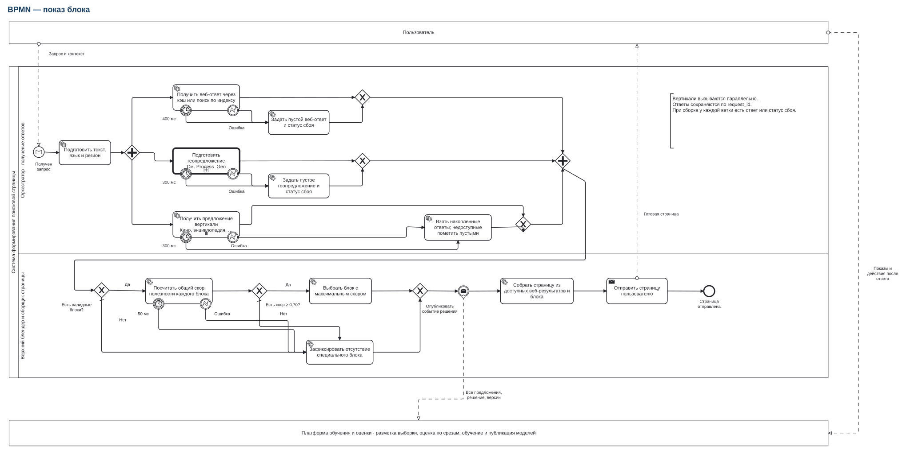
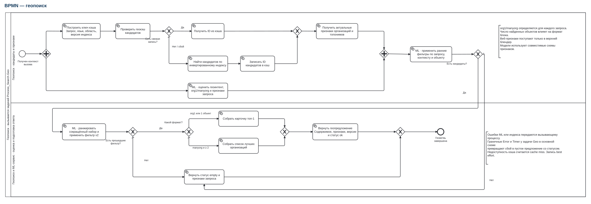

# Решение о показе специального блока в поисковой выдаче

Возьмём для примера Google: пользователь отправляет запрос в веб-поиск. Там разные вертикали работают параллельно, верхний блендер сравнивает предложения, а пользователь получает страницу, которая состоит не только из обычной выдачи, но и виджетов справа, которые могут быть разные — карта, фильм, Википедия или реклама. Мы рассмотрим конкретнее вертикаль Геопоиска, хотя общий принцип встраивания в выдачу у остальных тут такой же.

## 1. Компания, процесс и границы работы

За основу взят продукт Google Поиск; внутреннюю архитектуру для этого процесса я предлагаю сама. Рассматриваем процесс от получения запроса до отправки готовой страницы: найти результаты, подготовить предложения специальных блоков и решить, какой из них стоит показать. Для пользователя смысл в том, чтобы получить подходящий ответ сразу в выдаче, например карточку нужной организации или список мест.

На схемах есть веб-поиск, геопоиск и другие вертикали — кино, энциклопедия и ещё N похожих поставщиков блоков. Подробно разбирается только геопоиск. Рекламный аукцион, упомянутый во вступлении как часть страницы, в этот процесс не входит.

Внутри выбранной системы находятся оркестратор и сборщик страницы, веб-поиск, геопоиск, ML-сервис геопоиска, верхний блендер, индексы, кэши, реестр моделей и поток событий качества. Сбор исходных данных, обход сайтов, полное обучение моделей и внутреннее устройство остальных вертикалей оставлены за рамками. От них показаны только нужные взаимодействия.

### C4 Context: система целиком

Здесь вся система формирования страницы — один блок. Пользователь передаёт запрос и получает страницу, другие вертикали поставляют предложения, подготовка данных обновляет индексы, а платформа обучения получает события качества и публикует модели.

Геопоиск и блендер на этом уровне спрятаны внутри центрального блока. Другие вертикали вынесены наружу, потому что их устройство мы не разбираем: относительно выбранной границы это внешние поставщики. Это способ ограничить работу, а не утверждение об организационной структуре компании.

В C4 синий цвет обозначает систему и приложения, зелёный — хранилища и поток событий, серый — внешние системы. Подписи Person, Software System и Container уточняют тип элемента. Двунаправленная стрелка показывает обмен: в подписи сначала запрос, затем ответ. У связи с платформой обучения наружу идут события, обратно — модели и пороги.

### C4 Containers: из чего система состоит

Оркестратор параллельно вызывает веб-поиск, геопоиск и остальные вертикали. У веб-поиска и геопоиска есть свои кэши и индексы. Геопоиск обращается к ML-сервису за классификацией запроса, фильтрацией и оценками кандидатов. Модели геопоиска и блендера загружаются из реестра, события решений уходят в поток качества.

Важный момент со стрелками: оркестратор получает от геопоиска **предложение**, а от блендера — **решение о показе**. Сначала он собирает содержимое блоков и их признаки, затем передаёт предложения вместе с веб-признаками блендеру. В ответ получает идентификатор победителя или отсутствие победителя и только после этого собирает страницу. Геопоиск не может сам разрешить показ своей карточки.

Container здесь означает приложение или хранилище с отдельной ответственностью. Подпись под названием показывает выбранную технологию, а подпись на стрелке — данные и способ обмена.

### BPMN: общий процесс

Сначала подготавливаются текст запроса, язык и регион. Дальше параллельно запускаются веб-поиск, геопоиск и остальные вертикали. После получения ответов или завершения ожидания блендер оценивает валидные предложения и выбирает блок с максимальным скором, если тот проходит порог. Если подходящего блока нет, страница собирается из доступных обычных результатов.

На схеме есть и запасные пути. Таймаут или ошибка отдельной вертикали не должны останавливать всю страницу. При сбое блендера специальный блок не показывается. Уже полученные ответы других вертикалей сохраняются.

Прямоугольники со скруглёнными углами — задачи, круги — события. Ромб с плюсом запускает параллельные ветки или дожидается завершения каждой из них, ромб с крестом выбирает одну ветку либо объединяет альтернативные пути. Часы на границе задачи означают таймаут, молния — ошибку; здесь оба события прерывают ожидание и переводят процесс на запасной путь. Три вертикальные черты у задачи других вертикалей означают параллельное выполнение нескольких экземпляров. Задача геопоиска с толстой рамкой вызывает отдельный процесс, раскрытый на следующей картинке.

Сплошные стрелки задают порядок выполнения внутри процесса, пунктирные стрелки с кружком у начала — обмен сообщениями между участниками. Пунктирные связи с поясняющими заметками только привязывают текст к элементам.

### BPMN: что происходит в геопоиске

Геопоиск параллельно получает кандидатов и оценивает признаки запроса. Сначала проверяется геокэш; если записи нет или кэш недоступен, кандидаты ищутся в инвертированном индексе. После этого подтягиваются актуальные признаки организаций и топонимов.

Ранние фильтры сокращают набор по признакам запроса, пользователя и объекта. На оставшихся кандидатах выполняются ранжирование и фильтр v2. Если после любого этапа ничего не осталось, геопоиск возвращает пустой ответ.

Дальше выбирается формат предложения. Для запроса типа `org1` или единственного подходящего объекта собирается карточка топ-1. Для `manyorg`, если объектов несколько, — список. Тип запроса и количество найденных объектов — разные признаки: один результат сам по себе не означает, что запрос был `org1`.

На выходе получаются содержимое блока, признаки, версии моделей и статус. Это предложение ещё должно выиграть у других вертикалей в верхнем блендере.

## 2. Кто получает результат модели

Внутри геопоиска результаты классификаторов и ранжирования получает сам сервис геопоиска: они нужны, чтобы отфильтровать кандидатов, упорядочить их и собрать предложение. Наверх передаются скор геоинтента, оценки `org1/manyorg`, релевантность топ-1, число кандидатов и признаки географического соответствия.

Верхний блендер получает эти признаки вместе с предложениями остальных вертикалей и признаками веб-выдачи. Например, релевантная ссылка на Карты в обычном поиске может дополнительно поддержать геоблок. Скоры разных моделей нельзя просто сравнить между собой: блендер рассчитывает общий скор полезности каждого предложения. Вероятностями эти оценки можно называть только после проверки калибровки.

**Решение блендера получает оркестратор:** показать конкретный блок или не показывать ни одного. Пользователь получает уже собранную страницу.

Предложения, решения, причины отказов, таймауты и версии моделей записываются в поток событий. Показы и действия пользователя связываются с ними по идентификаторам запроса и кандидата. Платформа оценки использует эти данные для проверки качества: насколько полезны показанные блоки, сколько полезных предложений было пропущено, как меняются качество и задержки по языкам и регионам. В выборку для независимой разметки входят и показанные, и отклонённые предложения; клики используются как дополнительный сигнал с учётом позиции показа.

В BPMN события пользователя показаны как логическая связь с платформой оценки. На уровне контейнеров их технический путь проходит через оркестратор и поток событий.

## 3. Допущения

Точные границы сервисов, протоколы, настройки моделей и обработку сбоев снаружи не видно. Поэтому для схем я зафиксировала следующие решения.

| Что пришлось додумать | Как устроено на схемах |
| --- | --- |
| Место для блока | Рассматривается один специальный слот. Геопоиск и остальные вертикали конкурируют за него; обычная выдача формируется отдельно. |
| Границы сервисов | Оркестратор собирает предложения и вызывает отдельный блендер. Геомодели вынесены в отдельный ML-сервис. Остальные вертикали подключаются через общий принцип «запрос → предложение и признаки». |
| Контракт ответа | Предложение содержит идентификаторы запроса, вертикали и кандидата, тип и содержимое блока, признаки и версии. Ответы связываются по `request_id`; статусы — `ok`, `empty`, `timeout` или `error`. |
| Индексы | Для веб-поиска выбраны инвертированный индекс и HNSW по эмбеддингам документов. Для геопоиска — инвертированный индекс организаций и топонимов. |
| Устройство кэша | Кэшируется подбор кандидатов, а признаки и оценки обновляются после чтения. Геокэш хранит ID. Ключ учитывает запрос, язык, область, версию индекса и остальные параметры подбора; срок хранения ограничен. Ошибка чтения считается промахом, неудачная запись не прерывает ответ. |
| Геопайплайн | Признаки запроса считаются параллельно с поиском. Ранние фильтры работают до ранжирования, фильтр v2 — на сокращённом наборе. При `org1` или одном оставшемся объекте возвращается топ-1, при `manyorg` и нескольких объектах — список. |
| Ссылка на Карты | Используется как признак для блендера, но не гарантирует показ: нужны готовый геоблок и прохождение общего порога. |
| Бюджеты времени | На веб-ветку отведено 400 мс, на геопоиск — 300 мс, на группу остальных вертикалей — 300 мс, на блендер — 50 мс. Это выбранные для схем значения. |
| Выбор победителя | Общий скор лежит в диапазоне 0–1, порог показа — 0,70. При равенстве используется стабильный порядок по идентификаторам вертикали и кандидата. В реализации порог потребовал бы настройки по независимой оценке. |
| Частичные ответы и сбои | После таймаута сохраняются готовые предложения. Ошибка геомодели или геоиндекса даёт пустое предложение со статусом ошибки. Некорректный скор исключает кандидата; сбой блендера оставляет слот пустым. Таймаут прекращает ожидание, отмена удалённой работы выполняется по возможности. |
| Недоступность веб-поиска | Передаются пустая выдача и признак отсутствующих веб-фичей; предполагается, что блендер обучен работать с таким случаем. Если нет вообще никаких результатов, страница сообщает об их недоступности. |
| Обновление моделей | Совместимые версии заранее загружаются из реестра и фиксируются на время запроса. Артефакты неизменяемые, указатель активной версии обновляется атомарно. При неудачной загрузке остаётся последняя рабочая версия. |
| Обратная связь | Логируются все полученные предложения, включая отклонённые. Для оценки формируется выборка с независимой разметкой, после проверки качества публикуются новые модели и пороги. |
| Технологии | C++, Python/gRPC, Redis, OpenSearch, Kafka и S3-совместимое хранилище выбраны для этой архитектуры. По схемам нельзя делать вывод о фактическом стеке компании. |

## 4. Источники и что придумано мной

За основу взяты форматы поисковой выдачи и открытая документация Google о местном поиске. Она описывает показ организаций в Поиске и на Картах, а также роль релевантности, расстояния и известности. Внутреннее устройство сервисов из этого не следует: геопайплайн, фильтрация, ранжирование и конкуренция вертикалей на схемах — предложенный мной вариант реализации.

От себя я добавила конкретные границы приложений, технологии, формат обмена, устройство кэша, бюджеты времени, единый слот, порог выбора, правила обработки сбоев и контур обновления моделей. Эти решения перечислены выше как допущения. Схемы описывают согласованный вариант архитектуры на основе этого контекста.

Источники:

- [Google — результаты местного поиска](https://support.google.com/business/answer/7091?hl=ru): показ организаций в Поиске и на Картах, релевантность, расстояние и известность как факторы ранжирования.
- [C4 — System Context](https://c4model.com/diagrams/system-context) и [Containers](https://c4model.com/diagrams/container): границы и уровни детализации архитектурных схем.
- Camunda: [вызов отдельного процесса](https://docs.camunda.io/docs/components/modeler/bpmn/call-activities/), [параллельные шлюзы](https://docs.camunda.io/docs/components/modeler/bpmn/parallel-gateways/), [таймеры](https://docs.camunda.io/docs/components/modeler/bpmn/timer-events/) — обозначения и поведение элементов BPMN.

## 5. Файлы схем и как их открыть

Все четыре картинки вставлены выше. SVG можно отдельно открыть в браузере и увеличивать без потери качества.

| Схема | Картинка | Исходник |
| --- | --- | --- |
| Общий процесс | [bpmn-search.svg](bpmn-search.svg) | [bpmn-search.bpmn](bpmn-search.bpmn) |
| Геопоиск | [bpmn-geosearch.svg](bpmn-geosearch.svg) | [bpmn-geosearch.bpmn](bpmn-geosearch.bpmn) |
| C4 Context | [c4-context.svg](c4-context.svg) | [c4-context.mmd](c4-context.mmd) |
| C4 Containers | [c4-container.svg](c4-container.svg) | [c4-container.mmd](c4-container.mmd) |

Исходники BPMN открываются в редакторе с поддержкой BPMN 2.0, например Camunda Modeler. Общий файл [search-process.bpmn](search-process.bpmn) содержит обе диаграммы; в двух файлах из таблицы первой выбрана соответствующая схема. Файлы `.mmd` — текст Mermaid, их можно открыть в текстовом редакторе, а как схему — в просмотрщике с поддержкой Mermaid и раскладки ELK.

## 6. Соответствие BPMN и C4

BPMN показывает, что происходит с запросом, а C4 — какие приложения и хранилища за это отвечают. Поэтому одной задаче BPMN могут соответствовать несколько взаимодействующих контейнеров.

| Задача или участок BPMN | Кто отвечает на C4 Containers |
| --- | --- |
| Подготовить текст, язык и регион; запустить параллельные ветки и собрать ответы | Оркестратор и сборщик страницы |
| Получить веб-ответ через кэш или поиск по индексу | Веб-поиск, кэш веб-результатов и веб-индекс |
| Подготовить геопредложение — вызов отдельного процесса | Геопоиск |
| Построить ключ, проверить геокэш, получить или записать ID | Геопоиск и геокэш |
| Найти кандидатов, получить актуальные признаки организаций и топонимов | Геопоиск и геоиндекс |
| Оценить геоинтент и org1/manyorg, применить ранние фильтры, ранжировать и применить фильтр v2 | Геопоиск вызывает ML-сервис геопоиска |
| Собрать карточку топ-1 или список, вернуть предложение либо пустой ответ | Геопоиск |
| Получить предложение другой вертикали | Оркестратор вызывает внешние системы других вертикалей |
| Посчитать общий скор, проверить порог и выбрать блок | Верхний блендер |
| Обработать таймаут или ошибку вызова, использовать доступные ответы | Оркестратор и сборщик страницы |
| Опубликовать событие решения | Оркестратор отправляет данные в поток событий качества |
| Собрать и отправить страницу | Оркестратор и сборщик страницы |
| Обмен событиями и проверенными моделями с платформой оценки | Поток событий качества, внешняя платформа обучения и реестр моделей |

Параллельные и исключающие шлюзы — элементы управления процессом, отдельных контейнеров для них не требуется. Внутри геопоиска много задач BPMN, но это не означает, что для каждой нужен отдельный сервис.

